# eyetrack-bird

Dual-camera video oculography plus rigid-body head tracking for freely moving birds.

Two calibrated cameras and two IR lights give the 3D pupil center and the center of
corneal curvature on every frame (Barsingerhorn, Boonstra & Goossens 2018, *Behav Res
Meth*). A Qualisys (QTM) rigid body on the head gives head pose. Combining the two gives
each eye's position and optical axis in the head frame, without the animal having to
fixate calibration targets.

Contents: [Hardware](#hardware) · [Software](#software) · [Folder layout](#folder-layout) ·
[1. Camera settings](#1-camera-settings-spinview) · [2. Calibration](#2-calibration-capture) ·
[3. Recording setup](#3-recording-setup-qtm) · [4. Recording](#4-recording) ·
[5. Analysis (GUI)](#5-analysis-matlab) · [Coordinate frames](#coordinate-frames) ·
[Troubleshooting](#troubleshooting) · [Ground-truth experiment](#ground-truth-experiment)

---

## Hardware

| Part | Model | Notes |
|---|---|---|
| Cameras (2) | Blackfly S BFS-U3-27S5M | 2.8 MP mono, 2/3". Serial **22048634 = cam1 (LEFT)**, **21554508 = cam2 (RIGHT)** |
| Lenses (2) | Edmund Optics 25 mm f/1.4, #59871 | |
| IR LEDs (2) | LUXEON IR Domed 850 nm, LST1-01H01-IR01-01 ([Mouser 416-LST101H01IR0101](https://www.mouser.com/ProductDetail/416-LST101H01IR0101)) | Light 1 = LEFT, light 2 = RIGHT |
| LED power | 5 V, 2 A supply; 2× 2 Ω ≥3 W resistors | See wiring below |
| Mirror | Thorlabs ME2S-P01 (front-surface silver) | For locating the LEDs. Thickness is `P.mirror_thickness` in `src/eyetrackParams.m` (−0.1 mm) |
| Checkerboard | Uneven size (e.g. ≥4×5 squares), **4 mm squares** | Square size is `P.square_size` in `src/eyetrackParams.m` |
| Axes triangle | 3 passive IR markers on a right triangle | Labeled `p0` (right-angle corner), `px` (long edge), `py` (short edge); mounted tilted 45° so both QTM and the eye cameras see it |
| Head tracking | Qualisys motion capture + head marker rigid body | Rigid body must be the first one in the QTM export |

**LED wiring.** 5 V → switch → 2 Ω resistor → LED → GND, and a second resistor + LED
branch in parallel. A red indicator LED with a small series resistor shows power. Blue
lead = V+, orange = V−.

**Custom LED boards (made 2/2023, never used).** Starboard PCB `Starboard_2022-08-30.zip`
from PCBway, 19.9 × 20.2 × 1.6 mm, for OSRAM Oslon SFH 4717AS A01 high-power IR emitters
(Mouser 720-SFH4717ASAA1518). These might allow shorter exposures. Assembly: mark the
notch corner of each emitter with a silver marker dot before placing it on the board.

## Software

- MATLAB (tested on R2026a) with Computer Vision, Image Processing, and Signal Processing
  toolboxes.
- SpinView (Spinnaker SDK) for the Blackfly cameras.
- Qualisys Track Manager (QTM).
- Optional: PI MikroMove for the M-660 rotation stage (ground-truth experiment only).
- For capturing calibration images in the GUI: Image Acquisition Toolbox with the
  GenICam Interface support package (uses the Spinnaker driver).

The GUI's Settings tab lists each of these, marks the ones missing on the current
computer, and says how to install them (`src/checkRequirements.m`).

## Folder layout

Calibrations live in `Z:\Hannah\eyetrack\calibration\<YYMMDD>`, recordings in
`Z:\Hannah\eyetrack\behavior\<BIRD>_<YYMMDD>[a|b|...]`. The code finds a session's
calibration by the six digits after the **last underscore** in the session folder name,
so the calibration folder must be named with the recording date.

```
calibration\231212\
  cam1\  1.bmp 2.bmp ...        checkerboard images, camera 1 (4–10 images)
  cam2\  1.bmp 2.bmp ...        same poses, camera 2 (same file names)
  lights\
    cam1_light1.bmp             min exposure: only the LED spot, saturated (255)
    cam1_light1_checkerboard.bmp  long exposure: checkerboard on the mirror
    cam1_light2.bmp  cam1_light2_checkerboard.bmp
    cam2_light1.bmp  cam2_light1_checkerboard.bmp
    cam2_light2.bmp  cam2_light2_checkerboard.bmp
  axes\
    cam1.bmp  cam2.bmp          axes triangle, markers saturated
    qtm.mat                     QTM export with labeled markers p0, px, py
  calib.mat  axes.mat           written by calibrateCameras (delete to re-run)

behavior\HC13_230525\
  cam1*.mp4|avi  cam2*.mp4|avi  eye videos
  qtm.mat                       QTM 6DOF export (variable name qtm)
  beak.mat  eye.mat  eye_triangulate.mat              written by the pipeline
  head_calibration.mat  head_calibration_template.mat  results
```

---

## 1. Camera settings (SpinView)

Do this for **both** cameras.

1. Plug the LEDs into the 5 V supply. Set up the flat surface and camera module.
2. Open SpinView and confirm which camera is which (the GUI uses the serials in
   `src/eyetrackParams.m`): **22048634 = cam1 = left**,
   **21554508 = cam2 = right**.
3. *Features > Stream Parameters > Buffer Handling Control > Stream Buffer Handling Mode*
   = **Oldest First** (prevents dropped frames). This doesn't persist between sessions,
   so check it every time.

   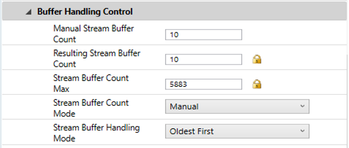

4. *Features > Blackfly S BFS-U3-27S5M > Acquisition Control*: trigger on the rising
   edge of the QTM TTL (Trigger Mode On, Source Line 3, Activation Rising Edge). Set
   Trigger Delay ≥ the QTM exposure (≥50 µs; 100 µs shown).

   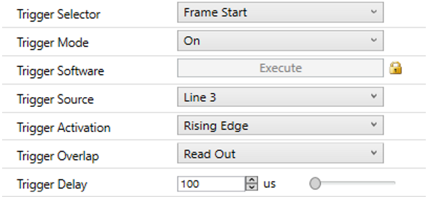

5. Exposure Mode **Timed**, Exposure Auto **Off**. Keep exposure shorter than the frame
   interval to avoid flicker from room lights (50 Hz → ≤18000 µs).

   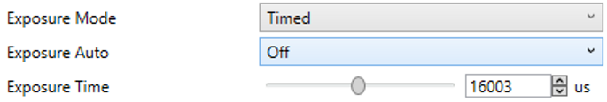

6. Optional: *Analog Control > Gain Conversion* = **HCG**.

   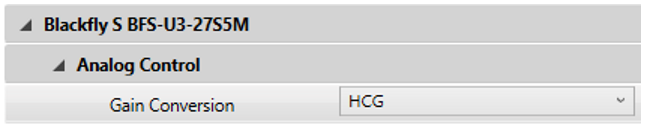

7. Save as a User Set.
8. To reduce frame buffering: Task Manager > Details > right-click `SpinView.exe` >
   Set priority > High.

## 2. Calibration capture

Don't move the cameras, lights, or QTM cameras after this. Capture in the GUI
(`eyetrackGUI`, Calibration tab); it saves each image under the name calibration
expects. Close SpinView first, since only one program can hold the cameras.

1. Set the QTM exposure to 50–80 µs so the QTM strobes don't reflect in the eye.
2. Calibrate QTM (wand + L-frame).
3. In the GUI, create today's folder (step 1 of the tab) and click **Connect cameras**.
   Both cameras show live in Preview while you position each target; exposure changes
   apply right away.
4. **Checkerboard.** Choose *Checkerboard pair*. Take 4–10 pairs with the checkerboard
   in different positions and orientations, holding it still for each **Save images**.
   They're saved as `cam1\1.bmp`, `cam2\1.bmp`, and so on.
5. **Lights.** Orient the mirror so that one LED is visible in both cameras at a time. For each light, save
   both items without moving anything:
   - *Light N: mirror checkerboard* (6 ms, so the checkerboard on the mirror shows)
   - *Light N: LED spot* (0.019 ms, so only the LED's reflection shows, saturated)
6. **Axes.** Put the axes triangle in view and choose *Axes triangle*. Raise the
   exposure until the markers saturate (Preview shows the saturated percentage). If
   that's hard, light the markers directly with a lamp behind the cameras.
   - **Save images** to get `axes\cam1.bmp` and `axes\cam2.bmp`.
   - Record a short QTM segment as `axes\qtm.qtm`. Label markers `p0`, `px`, `py`, then
     *File > Export > MAT* as `axes\qtm.mat`. The checklist turns red if the export is
     missing or doesn't have those three labels.

   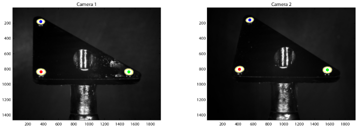

7. Each save runs the same detection calibration uses (checkerboard corners, mirror
   checkerboard, saturated LED spot, or the three axes markers) and marks it on the image;
   a failed check says to retake. To review or retake images, pick them in **Saved images** under the preview (or click
   their row in the checklist), then **Delete these images** and save them again. When the checklist has no red rows, click **Run calibration** and check the log (see
   [5. Analysis](#5-analysis-matlab), step 1).

While connected, the cameras run with their hardware trigger off (restored when you
disconnect), and **Save images** saves each camera's newest frame, so keep the target still. The
exposure presets are set in `src/eyetrackParams.m`. You can still capture in SpinView instead, using the file names
above.

## 3. Recording setup (QTM)

1. Make QTM wait for the space bar to start: *Project Options > Input Devices > Camera
   System > Synchronization > Wireless/software Trigger > Function* = **Start capture**.

   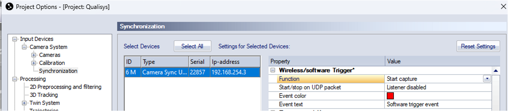

2. Same page, **Out 2**: Mode = Frequency divisor, TTL polarity Positive. QTM frame rate
   ÷ divisor = eye-camera frame rate (e.g. 300 Hz ÷ 6 = 50 Hz). This divisor is the
   `downsample_eye` value used in analysis. Duty cycle doesn't matter.

   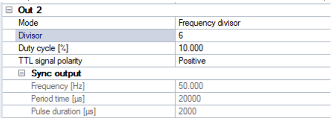

3. Set camera exposure at least 2 ms below the frame interval (14000 µs at 60 Hz, 17000
   µs at 50 Hz). Set the cameras to trigger on the TTL as in section 1.

## 4. Recording

1. **Don't move anything after the axes calibration.**
2. Place the bird in the arena with head markers on and food in front of the perch.
3. Close SpinView, open `eyetrackGUI`, and go to the **Record** tab. Enter the bird ID
   and click **Create new folder** (`<behavior root>\<bird>_<YYMMDD>`, with b, c, ...
   added if it exists). Click **Connect cameras** and check the live view and exposure
   (default 16 ms, from `P.record_exposure_ms`).
4. Pick **Save as**:
   - *Compressed* (default): H.264 on the NVIDIA GPU while recording, `cam1.mp4` and
     `cam2.mp4`. About 0.13 MB/frame (~45 GB/hour for both cameras) and about 1 gray
     level from raw, so it can go straight to Z:. Needs ffmpeg 7.1 at `P.ffmpeg`
     (ffmpeg 8+ needs NVIDIA driver 610 or newer).
   - *Raw*: lossless `cam1.avi` and `cam2.avi`, 2.8 MB/frame (~1 TB/hour). Too fast for
     Z:, so record to a local SSD and copy afterward. The GUI warns if the folder is on
     a network drive.
5. In QTM click Record, set the folder to the session folder and the file name to `qtm`,
   and start. QTM waits for the space bar.
6. Click **Record** in the GUI. The cameras switch to their hardware trigger and wait.
7. Press the space bar in QTM. Both frame counts in the GUI should climb together.
8. Stop QTM first, then click **Stop** in the GUI. The log reports frames acquired and
   written per camera and flags a mismatch. Export the QTM file with the head rigid body
   to `qtm.mat` (6DOF) in the session folder.

Benchmarked on a workstation (not yet with live cameras): two streams compressed at
~110 fps each and raw at ~87 fps each, against 50 fps needed.

### Recording with SpinView instead

1. In QTM click Record, set the folder and file name
   (`Z:\Hannah\eyetrack\behavior\HC13_230525\qtm`). Don't start yet.
2. In SpinView click Record for each camera:
   - File name `...\HC13_230525\cam1`, `...\cam2` (save raw images to the local SSD).
   - Capture 0 frames (= unlimited).
   - Video tab: frame rate 50 Hz, MJPEG quality 80 (or H264, bitrate 10,000,000).
3. Hit Record in QTM. Don't press the space bar yet.
4. Check exposure (≤ 1/fps, e.g. 18000 µs at 50 Hz) and gain (e.g. 10).
5. Hit Record for both cameras in SpinView.
6. Press the space bar in QTM. The cameras only capture frames while QTM sends TTLs,
   so this synchronizes everything.
7. Stop QTM first, then the cameras. Export the QTM file with the head rigid body to
   `qtm.mat` (6DOF).

## 5. Analysis (MATLAB)

### GUI

```matlab
cd C:\Users\Hannah\Dropbox\_LAB\Code\eyetrack-bird\scripts
eyetrackGUI
```

| Tab | What it does |
|---|---|
| Settings | Calibration and behavior session roots, checkerboard square size, axes threshold, QTM downsample factor, beak click spacing. Defaults come from `src/eyetrackParams.m`; "Save as my defaults" stores your edits in MATLAB preferences. Also lists the toolboxes and software this computer is missing. |
| Calibration | Pick or create a `YYMMDD` folder, connect the cameras, and save each calibration image (saved under the right name, and checked right away with the same detection calibration uses), with a live view for positioning. A checklist marks missing images in red, including a QTM export without p0/px/py labels. **Saved images** shows any saved pair, and **Delete these images** removes it to retake. **Run calibration** runs `calibrateCameras` and prints reprojection error, light positions, and camera/light order to the log. |
| Record | Creates a session folder, shows the cameras live, and records both on QTM's trigger, compressed (GPU H.264) or raw. Walks through the QTM steps and reports frame counts at Stop. See [4. Recording](#4-recording). |
| Behavior | Checks a behavior session's videos, `qtm.mat`, and matched calibration. Preview the tracker on any frame, edit settings per camera, draw a crop around each eye, then **Label beak → Track eyes → Analyze**. **Stop tracking** saves progress, and **Track eyes** resumes from there. |
| Birds | Lists birds in the behavior session root and each behavior session's status. **Run selected birds** combines sessions per bird (`runEyetrackAll`), and **Summary plot** runs `plotEyetrack`. |

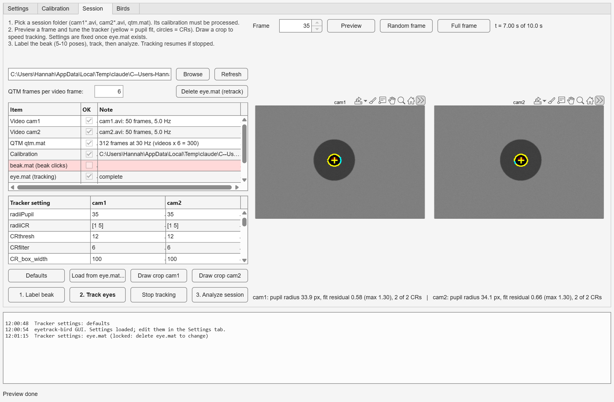

Tracker settings are saved in `eye.mat` and locked once tracking starts. To change them,
use **Delete eye.mat (retrack)**. **Load from eye.mat...** copies settings from another
session.

### Scripts

The same steps without the GUI are in [`scripts/RUNME.m`](scripts/RUNME.m). Paths and
constants are in [`src/eyetrackParams.m`](src/eyetrackParams.m), and tracker defaults are
in [`src/defaultTrackerParams.m`](src/defaultTrackerParams.m).

1. **Process the calibration.**
   ```matlab
   addpath('C:\Users\Hannah\Dropbox\_LAB\Code\eyetrack-bird\src')
   [C, A] = calibrateCameras('Z:\Hannah\eyetrack\calibration\231212');
   ```
   Compare the figures with the examples below. Mean reprojection error should be well
   under 1 px, with the LED spot found in all four images. The triangle markers should
   be sorted red = `p0`, green = `px`, blue = `py`, and the QTM and camera distances
   printed in the command window should match. Results are cached in `calib.mat` and
   `axes.mat`; delete them or pass `force = 'all'` to re-run. To drop a bad checkerboard pair, delete its images and run calibration again.

2. **Track one session** (`runEyetrackSingle(session_folder, downsample_eye)`) or all
   sessions for a bird (`runEyetrackAll('Z:\...\behavior\HC13_2*', downsample_eye, 1)`).
   For each session this:
   1. Asks you to click the beak tip in cam1, then cam2, every 45 frames. Collect 5–10
      pairs with the head in different poses. Right-click skips ahead, Enter finishes.
      Saved to `beak.mat`. For a whole bird it only asks in the first session.
   2. Tracks the pupil and both corneal reflections in every frame, starting with a
      preview frame at `example_t` s. If the fit is poor, stop, change the settings,
      delete `eye.mat`, and restart. Progress saves every 100 frames, and re-running
      resumes.
   3. Triangulates pupil, cornea, and beak, converts them to the common frame, and fits
      the head/eye geometry.

3. **Summarize across birds**: `plotEyetrack(data_root, dir_roots)`.

To re-run a step, delete its cached file: `calib.mat`/`axes.mat` (calibration),
`beak.mat` (beak clicks), `eye.mat` (tracking), `eye_triangulate.mat` (3D points).
If you add beak clicks later, delete `eye_triangulate.mat` so the beak is triangulated
(the GUI does this for you).

### Example calibration output

Checkerboard (stereo calibration and reprojection error):

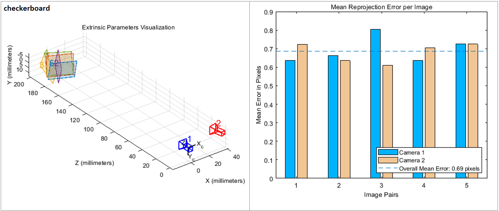

Lights (LED spot and mirror checkerboard per image; right, top-down view of cameras in
cyan and lights in red/magenta):

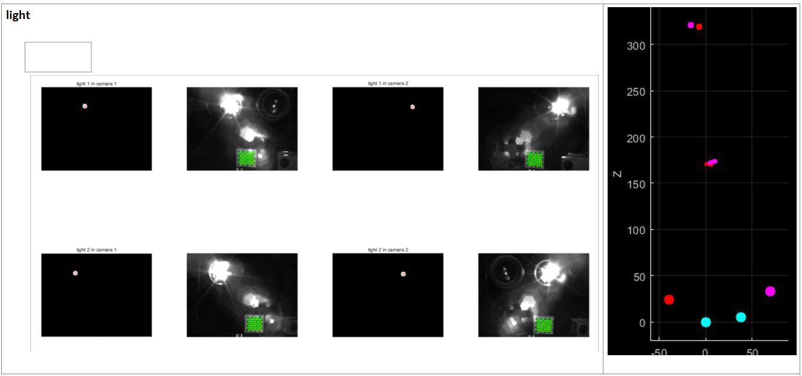

Axes (triangle markers in each camera; right, the triangle as seen by QTM and by the eye
cameras, before and after the 45° correction):

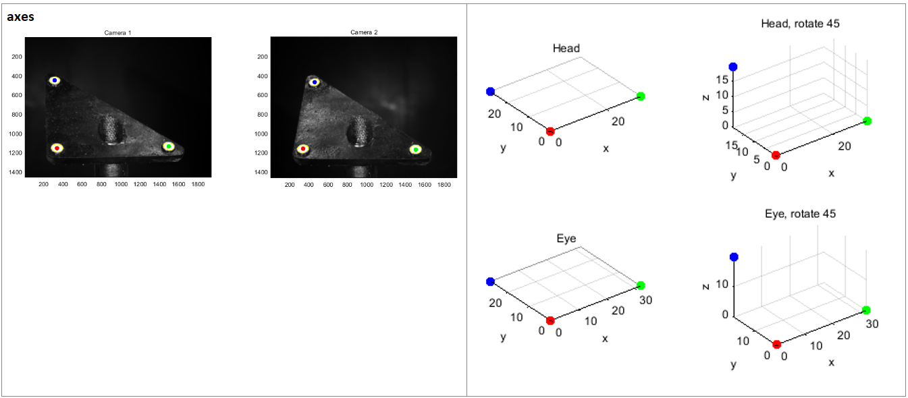

## Coordinate frames

- **Camera frame** (`C`, `estimatepandc`): origin at camera 1's optical center, x along
  image columns, y down image rows, z along the optical axis away from the cameras. mm.
- **Common frame** (`alignCommonReferenceFrame`): defined by the axes triangle, origin at
  `p0`, x toward `px`, rotated 45° about x so z is vertical. Both camera and QTM data are
  mapped into it.
- **Head frame** (`H.R_head`, relative to the QTM rigid body): x from the midpoint of the
  eyes to the beak tip, y toward the left eye (orthogonalized), z up.
- **Angles** (`Ht`): `theta = atan2d(y, x)` is azimuth, `phi = acosd(z / r)` is the polar
  angle from +z, so elevation = 90° − phi. Converting back:
  `x = r·sin(phi)·cos(theta)`, `y = r·sin(phi)·sin(theta)`, `z = r·cos(phi)`.
  (If you use elevation `el = 90° − phi` instead: `x = r·cos(el)·cos(theta)`,
  `y = r·cos(el)·sin(theta)`, `z = r·sin(el)`.)

## Troubleshooting

- **SpinView stops saving after a few minutes** (memory). If it seems frozen, don't
  force-quit. Stop QTM first, then press Ctrl+Shift+Esc, bring the error windows to the
  front, and click OK. Frames recorded before failure in testing:

  | Format | Frames before failure | Resources |
  |---|---|---|
  | MJPEG quality 80 | 7500 | CPU ~50%, disk low |
  | MJPEG quality 90 | 7100 | CPU ~50%, disk low |
  | H264 bitrate 8,000,000 | 3400 | CPU ~100%, disk low |
  | Uncompressed TIFF | 1900 | |

- **Dropped frames**: check Acquisition Frame Rate and Device Link Throughput Limit in
  SpinView.

  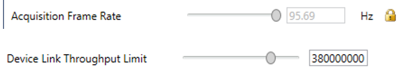

- **Frame counts don't match**: `runEyetrackAll` prints video frames × `downsample_eye`
  next to the QTM frame count. They should agree; extra QTM frames are cropped.
- **Cameras or lights swapped**: a warning prints if light 1 isn't left of light 2 or
  cam1 isn't left of cam2. Fix the calibration file names, or for an already tracked
  session run `scripts/swapCameras.m` in the session folder (overwrites `eye.mat` and
  `beak.mat`).
- **"reverse eye orientation" warning**: the beak is behind the eyes in the rigid-body
  frame; check the beak clicks.

## Ground-truth experiment

Validates eye-angle measurements against known rotations (`scripts/groundtruth.m`).

- PI M-660 rotation stage, controlled with
  [PI software](https://www.pi-usa.us/en/products/precision-motion-controllers-and-drivers-for-positioning-systems/c-8672u2-piline-motion-controller-412418438#downloads).
- Prepare anesthetics, saline syringe, surgical tools, eye spear, dental rubber bands and
  applicator. Set up the motor software, rigid-body markers on the motor, and calibrate
  QTM.
- Anesthetize with isoflurane + ketamine/xylazine (0.1 ml each). Place in 3D-printed ear
  bars in the surgery room, then move to the rig and position.
- Overdose with a second dose. Once death is confirmed, cut away the skin around one eye
  with forceps and serrated scissors. Avoid getting feathers in the eye; if needed, wipe
  gently with a pre-moistened eye spear.
- Record in 1° steps over ±25°: start QTM and the cameras as above, then the motor
  sequence. Run 5–6 times in both directions. Repeat for the other eye.
- See the paper for other methods.
